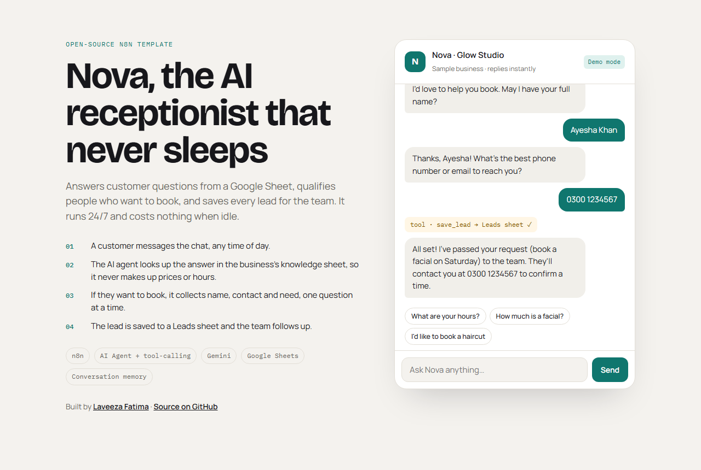
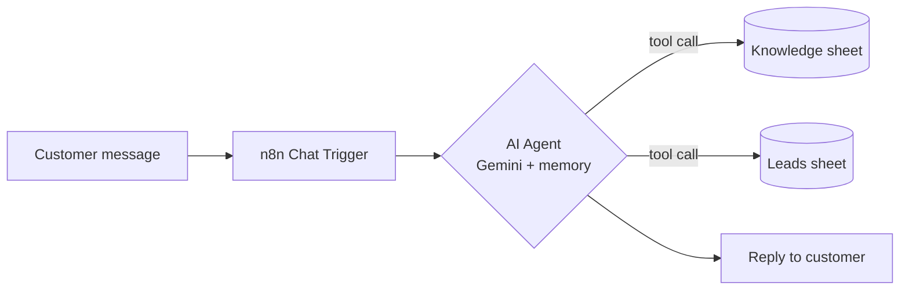

# Nova: AI Receptionist (n8n template)

An AI receptionist for small service businesses (salons, clinics, studios, agencies).
It **answers customer questions from a Google Sheet**, **qualifies people who want to book**, and
**saves every lead** for the team, 24/7.

**▶ Live demo:** https://laveeza-fatima.github.io/ai-receptionist-agent/
(The demo runs scripted replies in your browser. Connect your own n8n instance to make it a real AI. See [Go live](#6-go-live-with-the-real-ai).)



---

## 1. What it does

| Customer says…                        | Nova…                                                                 |
|---------------------------------------|-----------------------------------------------------------------------|
| "How much is a facial?"                | Calls `search_knowledge_base`, answers **only** from your sheet        |
| "Are you open on Sunday?"              | Same, and it never invents hours or prices                            |
| "I'd like to book a haircut"           | Collects name → phone/email → need, **one question at a time**        |
| (after it has all three)               | Calls `save_lead`, which appends a row to your **Leads** sheet, and confirms |
| Something not in the sheet             | Says it doesn't know and offers to take their details                 |

## 2. How it works



- **n8n AI Agent** with tool-calling decides when to look something up and when to save a lead.
- **Google Gemini** is the language model (swap in OpenAI or any model n8n supports).
- **Window memory** keeps the last 20 messages, so the conversation stays coherent.
- **Google Sheets** holds the knowledge base and leads, so a non-technical owner can edit answers without touching the workflow.

## 3. Repo contents

```
├── index.html                    # Chat demo page (works standalone; connects to n8n when configured)
├── workflow/ai-receptionist.json # Import this into n8n
├── sample-data/
│   ├── knowledge-base.csv        # Example FAQ rows → your "Knowledge" tab
│   └── leads.csv                 # Column headers → your "Leads" tab
└── docs/demo.png                 # Screenshot used above
```

## 4. Setup (≈10 minutes)

1. **Google Sheet:** create a sheet with two tabs:
   - `Knowledge`: import `sample-data/knowledge-base.csv` (columns `topic, question, answer`) and edit it for your business.
   - `Leads`: import `sample-data/leads.csv` (columns `timestamp, name, contact, need, status`).
2. **n8n:** use [n8n Cloud](https://n8n.io) or self-hosted. Go to *Workflows → Import from file* and pick `workflow/ai-receptionist.json`.
3. **Credentials:**
   - *Gemini Chat Model* node: add a Google Gemini API key (free tier at [Google AI Studio](https://aistudio.google.com)).
   - *search_knowledge_base* and *save_lead* nodes: connect your Google account and replace `PASTE_YOUR_GOOGLE_SHEET_URL_HERE` with your sheet's URL.
4. Click **Open chat** in n8n and try: *"How much is a haircut?"* then *"I want to book one"*.
5. **Activate** the workflow.

## 5. Customise

- **Personality / rules:** edit the *System Message* in the **AI Receptionist** node.
- **Business info:** just edit the `Knowledge` tab. No workflow changes needed.
- **More fields** (preferred date, budget…): add a column to `Leads` and a matching `$fromAI(...)` field in **save_lead**.
- **Another model:** replace the Gemini node with the OpenAI / Anthropic / Ollama chat model node.

## 6. Go live with the real AI

1. In n8n, open the **When chat message received** node → copy the **Chat URL**.
   Under *Allowed Origins (CORS)*, add the site where `index.html` is hosted (e.g. `https://laveeza-fatima.github.io`).
2. In `index.html`, set:
   ```js
   const N8N_CHAT_URL = "https://YOUR-N8N-DOMAIN/webhook/…/chat";
   ```
3. Reload. The badge switches from **Demo mode** to **Live AI**.

## 7. Roadmap

- [ ] WhatsApp and Instagram DM channels
- [ ] Calendar availability + direct booking
- [ ] Owner notification (email / WhatsApp) on each new lead
- [ ] Multi-language replies

---

Built by **Laveeza Fatima**, AI Agents & Automation Engineer · [Portfolio](https://laveeza-fatima.github.io) · [LinkedIn](https://www.linkedin.com/in/laveeza-fatima-320a2031b/)

> This is an open, simplified template for learning and demos. Client production systems are custom-built and kept private.

Licensed under the [MIT License](LICENSE).
